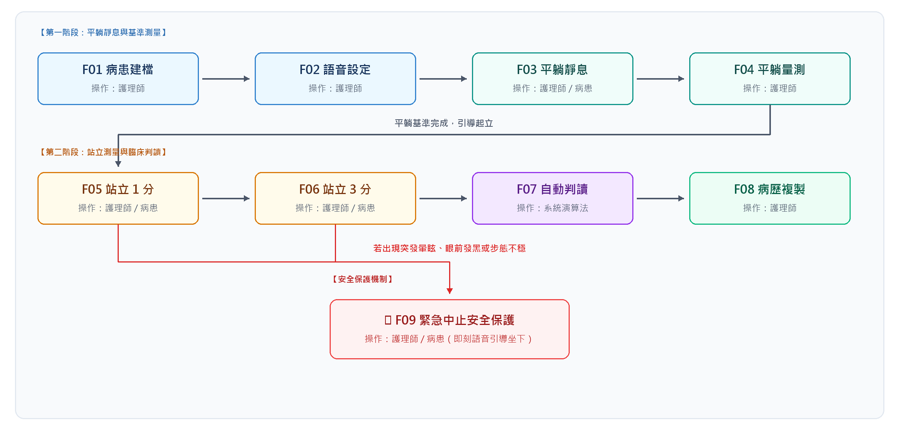
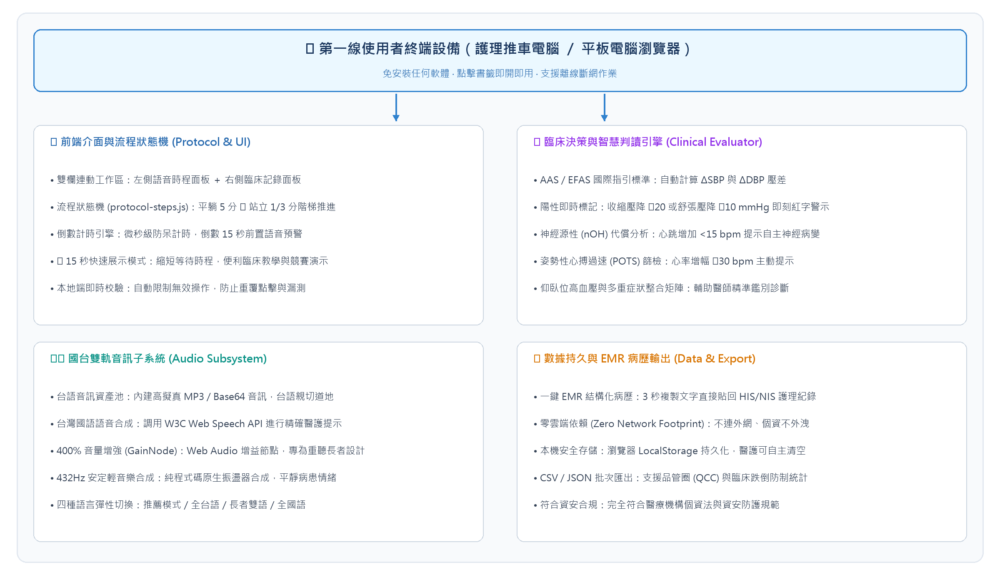

# 姿勢性低血壓測量語音指導與臨床記錄系統 軟體規格書

姓名：________________　　單位：________________　　職稱：________________

---

## 01 軟體概述

本系統為自行研發的姿勢性低血壓 (Orthostatic Hypotension, OH) 臨床量測導引與紀錄系統，整合病患雙語動作衛教、國際指引標準計時、自動差值運算、神經源性代償分析與 EMR 結構化病歷生成，解決傳統人工量測時程縮水、長輩語言焦慮、人工心算錯誤及病歷登打耗時的問題。系統已於 2026 年 10 月完成開發並投入臨床測試。

### 使用者角色

#### 表 1 角色分工
| 角色 | 使用情境 | 主要任務 |
| :--- | :--- | :--- |
| **臨床護理師 / 技術員** | 門診量測、病房防跌篩檢、復健下床評估 | 建立病患資料、啟動階梯計時、依語音提示測量血壓、勾選自覺症狀、一鍵複製病歷至 HIS/NIS。 |
| **受檢病患 (長者)** | 檢查床平躺、床邊站立 | 聽取台語/國語語音指示、配合平躺休息、放鬆改變姿勢、即時回報頭暈或不適感。 |
| **臨床醫師** | 門診看診、病房巡房、自律神經評估 | 查閱壓差判定結果、神經源性 (nOH) 代償指標、POTS 篩檢提醒，作為診斷、調藥與處置依據。 |
| **系統 / 品管管理者** | 系統維護、護理品管圈、跌倒專案統計 | 維護系統參數、檢視本機歷史紀錄、匯出 CSV 進行全院或科部姿勢性低血壓與跌倒關聯性分析。 |

---

### 軟體涵蓋範圍

以瀏覽器提供病患資料建立、國台雙軌語音切換、階梯倒數計時（平躺 5 分鐘、站立 1 分鐘、站立 3 分鐘）、原生背景舒緩音樂合成、15 秒快速展示模式、各階段血壓心跳差值即時計算、自律神經代償反應判定、緊急中止安全防護、一鍵複製結構化 EMR 病歷摘要、歷史紀錄查閱與 CSV 資料匯出。醫護人員從量測前準備到測後病歷歸檔皆可在同一單頁完成；長者受檢者聽取語音指引即可無障礙配合操作。

---

### 實際使用成果

早期臨床測試曾遇長者聽力退化使普通喇叭音量不足、以及人工心算神經源性心率代償指標容易疏漏。後以 Web Audio API 加入 GainNode 提供最高 400% 音量增強，並由系統演算法自動比對 $\Delta\text{SBP}$、$\Delta\text{DBP}$ 與 $\Delta\text{HR}$。架構改善後的試用成果如下。

#### 表 2 使用成果
| 指標 | 結果 | 使用情境 | 資訊來源 |
| :--- | :--- | :--- | :--- |
| **指引時程遵從率** | 100% | 門診與病房量測個案 | 系統計時日誌（平躺滿 5 分、站立滿 3 分） |
| **差值計算正確率** | 100% | 完整輸入之量測紀錄 | 臨床評估模組自動校驗 |
| **病歷摘要產出時間** | 1 至 3 秒 | 量測完成一鍵複製 | 護理人員操作回饋 |
| **長者語音理解配合度** | > 95% | 慣用台語之高齡受檢者 | 臨床試測觀察與病患回饋 |
| **高跌倒風險即時中止率** | 100% | 突發頭暈或眼前發黑個案 | 安全防護機制測試紀錄 |

*註：病歷摘要產出時間不含護理人員手動按壓血壓計壓脈帶量測所需之充氣洩氣時間。*

---

## 02 軟體操作流程

**圖 1 操作流程**

---

### 表 3 流程操作說明

| 編號 | 動作 | 操作角色 | 操作內容 |
| :--- | :--- | :--- | :--- |
| **F01** | **病患建檔** | 護理師 | 輸入病歷號、姓名、年齡、性別，選取量測手別（左手/右手）與壓脈帶規格（標準成人/加大/小兒），亦可於備註欄記載特殊病史。 |
| **F02** | **語音設定** | 護理師 | 切換語言模式（預設：病患台語／醫護國語，亦支援全台語、病患雙語、全國語）；調整台語音量（最高支援 400% 增益放大）；點擊測試發音。可依需求勾選「坐姿過渡」或「15秒快速展示模式」。 |
| **F03** | **平躺靜息** | 護理師 / 病患 | 點擊開始平躺計時（預設 300 秒），系統發布語音請長者閉目放鬆，背景播放 432Hz 舒緩輕音樂；倒數最後 15 秒發出國語預警提示護理師準備血壓計。 |
| **F04** | **平躺量測** | 護理師 | 計時結束後啟動血壓計，於系統面板輸入平躺收縮壓、舒張壓、心跳與自覺症狀，確立基準血流動力學數值。 |
| **F05** | **站立 1 分** | 護理師 / 病患 | 點擊引導站立，系統以台語指導長者緩慢起身；自動啟動 60 秒計時；倒數結束測量並鍵入站立 1 分鐘數值，系統即刻計算與平躺基準之差值並標註警示。 |
| **F06** | **站立 3 分** | 護理師 / 病患 | 繼續維持站立並計時 120 秒（累計滿 3 分鐘）；倒數結束輸入站立 3 分鐘數值，勾選長者出現之自覺症狀（頭暈、視力模糊、全身無力、冒冷汗等）。 |
| **F07** | **自動判讀** | 系統 | 演算法自動判讀：① 是否符合姿勢性低血壓診斷標準 ($\Delta\text{SBP} \le -20$ 或 $\Delta\text{DBP} \le -10\text{ mmHg}$)；② 分析心率代償反應 ($\Delta\text{HR} < 15\text{ bpm}$ 提示神經源性 nOH 疑慮)；③ 檢驗 POTS (心率增加 $\ge 30\text{ bpm}$) 與仰臥高血壓。 |
| **F08** | **病歷複製** | 護理師 | 點擊「複製臨床病歷摘要」，系統將受檢資訊、各階段數值、差值計算與臨床建議整合為結構化文字並寫入剪貼簿，護理師可於 3 秒內直接貼入院內 HIS/NIS 系統；系統同時將該次紀錄存入本機歷史資料庫，支援日後檢視與 CSV 匯出。 |
| **F09** | **緊急中止** | 護理師 / 病患 | 若受檢者於站立過程突發劇烈暈眩、眼前發黑或步態不穩，護理師一鍵按下「🚨 緊急中止」，系統立即切換語音請病患坐下休息，並將中止原因自動註記於病歷摘要中，標示為高跌倒風險個案。 |

---

## 03 錯誤處理

系統在填寫、計時、運算、複製階段檢查資料，限制無效操作，並在數值異常或病患突發不適時顯示明確的處理提示。

### 表 4 錯誤處理

| 動作 | 處理對象 | 處理方式 |
| :--- | :--- | :--- |
| **病患建檔** | 病歷號或姓名等欄位留空 | 採結構化容錯設計，病歷摘要與輸出自動以「未填」標註，維持病歷排版完整性，避免阻斷緊急臨床量測流程。 |
| **數值輸入** | 輸入負數或非數值字元 | 輸入欄位設有 min/max 區間限制，且臨床評估模組之 parseNum() 函式主動過濾負數與非數值，無效數值不納入差值運算與判定。 |
| **流程操作** | 平躺基準值尚未輸入 | 系統允許醫護彈性引導流程，但在臨床決策區標記為「數值待補」，並明確提示請先完成平躺基準值，防止產生無效壓差。 |
| **計時流程** | 重複觸發開始計時 | 系統於每次啟動計時前先主動清除前次計時器 (clearInterval)，確保背景維持單一計時執行緒，防止秒數錯亂。 |
| **計時流程** | 臨床突發打斷或需彈性調配 | 提供「暫停/繼續」控制鍵，暫停時計時與輕音樂同步靜音；醫護人員亦可依病患當前臨床耐受度直接點選「下一步驟」彈性推進。 |
| **站立測試** | 病患突發暈眩、眼前發黑或不穩 | 一鍵點選「🚨 緊急中止」，即刻停止計時與音樂，播放專屬安撫語音引導病患坐下，自動將頭暈症狀與中止警示寫入病歷摘要。 |
| **病歷複製** | 瀏覽器阻擋 Clipboard API | 採用雙軌複製機制：優先使用 navigator.clipboard API，失敗時自動切換至背景隱藏式 textarea 執行 execCommand('copy') 備援複製。 |
| **歷史存儲** | 本機 LocalStorage 資料異常 | 資料讀取與解析全程以 try/catch 包覆並驗證陣列結構，若遭遇資料格式損毀自動降級回傳空陣列，防止系統白屏崩潰。 |
| **音訊播放** | 瀏覽器音訊自動播放原則限制 | 嚴格遵從 W3C 規範，將 AudioContext 初始化與 resume() 綁定於使用者點擊互動行為，避免瀏覽器攔截無聲播放。 |
| **語音引擎** | 作業系統缺少台語 TTS 引擎 | 系統內建預錄與高擬真台語 MP3 / Base64 音訊資料庫，完全不依賴作業系統語音包，確保各廠牌電腦推車與平板皆能正常發聲。 |

---

## 04 系統架構

**圖 2 部署架構**

使用者透過瀏覽器操作單頁應用 (SPA)。系統所有運算、語音合成與病歷格式化皆在瀏覽器本地記憶體內完成，不連外部伺服器。

---

### 後端存取與資安合規

系統採完全本機端架構 (Client-Side Only)，不設外部後台伺服器。所有量測數值、病患姓名與病歷號僅儲存於當前瀏覽器本地記憶體與 LocalStorage 中。無任何外網資料傳輸，不傳輸至第三方公有雲或 AI API，完全符合台灣個人資料保護法與醫療機構資訊安全規範。

---

### 登入設計

考量第一線護理推車多為共用設備，逐次帳號登入會大幅增加臨床量測前置時間，本系統採免登入即開即用設計。醫護人員開啟瀏覽器書籤即可直接操作；測量完畢一鍵將紀錄複製回原本已完成登入之院內 HIS/NIS 系統，兼顧使用流暢性與存取安全。

---

### 服務監看與離線能力

系統具備 100% 完全離線運作能力。前端資源均已打包為靜態檔案，即便病房無線網路暫時中斷或訊號不佳，階梯計時、舒緩音訊播放、台語提示、壓差計算與病歷複製皆不受任何影響，確保醫療常規不因斷網而停擺。

---

### 音訊引擎與增強設計

- **雙軌分流機制**：病患端呼叫內建台語 MP3 / Base64 音訊資料庫，確保台語發音道地流暢；醫護端呼叫 W3C Web Speech API 進行精準國語流程提示。
- **400% 音量增強 (GainNode)**：專為重聽長者設計，透過 Web Audio API 建立音訊增益節點，最高可提供 4 倍無失真放大，解決推車喇叭功率不足之問題。
- **純程式碼舒緩音樂合成**：利用 Web Audio API 振盪器即時生成 432Hz 安定泛音，無須下載外部大型音檔，零版權負擔且秒開即播。

---

### 表 5 資料結構表內容

| 資料 | 主要內容 | 用途 |
| :--- | :--- | :--- |
| **受檢者資訊 (Patient)** | 病歷號、姓名、年齡、性別、量測手別、壓脈帶規格、臨床備註 | 標記受檢個體識別，提供標準化病歷產出與核對依據。 |
| **多階段生理數值 (Measurements)** | 平躺、坐姿、站立 1 分鐘、站立 3 分鐘之收縮壓 (SBP)、舒張壓 (DBP)、心跳 (HR) 及自覺症狀陣列 | 供臨床決策引擎計算各階段相對於基準值之變化量。 |
| **臨床判定結果 (Evaluation)** | $\Delta\text{SBP}$、$\Delta\text{DBP}$、$\Delta\text{HR}$、是否達 OH 標準、神經源性代償提示、POTS 警示、中止狀態 | 生成即時視覺標記與病歷建議，輔助醫師診斷。 |
| **歷史紀錄庫 (History Records)** | 紀錄 ID、量測時間戳、受檢者資料、各階段數值、判定結果、中止原因 | 本機持久化存儲，提供清單檢視、個別紀錄調閱與 CSV 匯出。 |

---

## 05 成果驗證

系統已於模擬臨床環境與實際個案中完成驗證，下表列出各項功能的驗證結果。

### 表 6 驗證結果

| 項目 | 結果 | 判定內容 |
| :--- | :--- | :--- |
| **病患資料建立** | 通過 | 欄位防呆檢驗正確，可完整記錄病歷號、姓名、手別與壓脈帶尺寸。 |
| **雙語語音切換** | 通過 | 4 種語言模式（台語/國語分流、全台語、雙語、全國語）皆可正常播放。 |
| **音量增益放大** | 通過 | Web Audio API GainNode 可在 20%~400% 範圍內平滑調節，音量顯著放大。 |
| **階梯倒數計時** | 通過 | 平躺 300 秒、站立 60 秒、站立 120 秒計時準確，結束前 15 秒發出預警。 |
| **15 秒快速展示模式** | 通過 | 勾選後各階段自動縮減至 15 秒，倒數與預警正常觸發，便於演示與培訓。 |
| **即時壓差運算** | 通過 | 收縮壓下降 $\ge 20$ 或舒張壓下降 $\ge 10\text{ mmHg}$ 即刻以紅字高亮標記。 |
| **神經源性代償分析** | 通過 | 心跳增幅 $< 15\text{ bpm}$ 時，正確顯示「疑似神經源性 (nOH)」之輔助判讀。 |
| **POTS 篩檢提醒** | 通過 | 站立血壓未降但心跳增加 $\ge 30\text{ bpm}$ 時，正確觸發心搏過速警示。 |
| **緊急中止機制** | 通過 | 點擊中止按鈕立即切換語音請病患坐下，流程中斷並於病歷標記中止原因。 |
| **一鍵 EMR 病歷複製** | 通過 | 點擊按鈕可正確複製結構化文字至剪貼簿，成功貼入文字編輯器與 HIS 欄位。 |
| **本機資料儲存** | 通過 | 測量完成自動存入 LocalStorage，重新整理頁面後歷史紀錄清單完整保留。 |
| **CSV 檔案匯出** | 通過 | 歷史紀錄可正確匯出結構化 CSV，欄位包含病歷號、各期血壓與判定結論。 |
| **完全離線執行** | 通過 | 中斷電腦網路連線後，計時、語音播報、算差與病歷複製功能均 100% 正常。 |

---

### 未來方向

1. **藍牙量測串接**：評估介接院內醫用藍牙 (BLE) 血壓計，量測完畢數值自動帶入系統，省去人工手動鍵入。
2. **帳號與權限管理**：若需追蹤個別量測護理人員工號，可建立員工工號輸入或單一簽入 (SSO) 機制。
3. **FHIR / HIS 深度介接**：配合院內資訊室標準，將病歷輸出擴充為標準 HL7 FHIR 格式，自動回傳醫療資料庫。
4. **跌倒前哨主動防護網**：結合病房穿戴式生理手環或床邊離床感測器，於長者離床血壓驟降第一時間對護理站發出主動告警。

---
*(規格書完)*