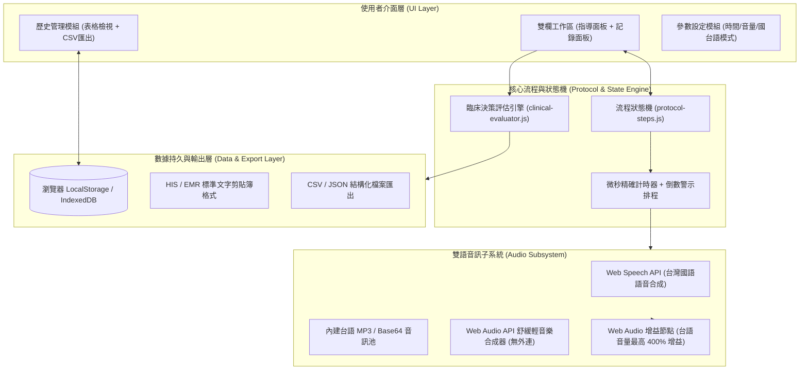
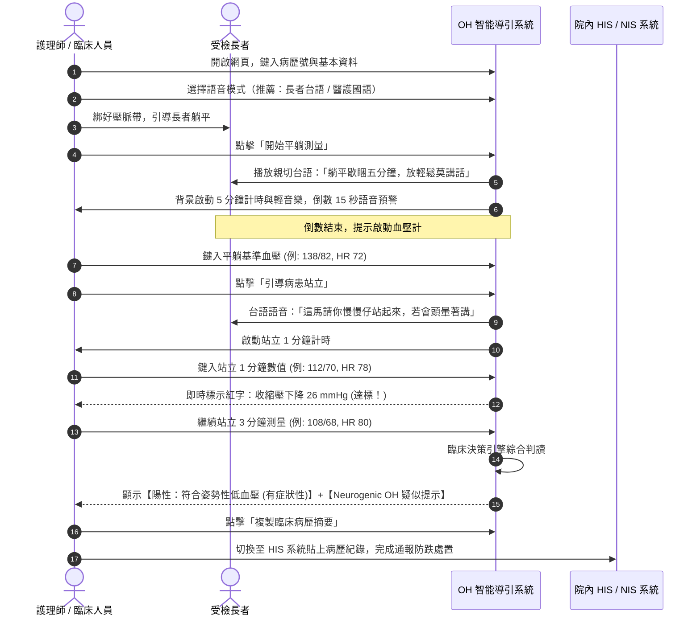

# 第一屆 Vibe Coding AI 應用開發競賽
# 產品需求規格書 (Product Requirements Document, PRD)

---

## 專案基本資訊
- **專案名稱**：姿勢性低血壓 (OH) 測量語音指導與臨床記錄系統 (台灣國語／台語雙語臨床版)
- **英文名稱**：Orthostatic Hypotension Guided Measurement & Clinical Documentation System (Taiwanese/Mandarin Clinical Edition)
- **參賽組別**：第一屆 Vibe Coding AI 應用開發競賽
- **核心目標**：透過 AI 生成語音與純前端 Web 互動技術，將繁瑣的姿勢性低血壓臨床測量標準化，大幅降低醫護負擔、消除長者白袍焦慮、消除人工計算錯誤，守護高齡病患防跌安全。
- **文件版本**：v1.0 (正式審查版)
- **文件日期**：2026 年 11 月

---

## 目錄
1. [開發動機與臨床痛點 (Motivation & Clinical Unmet Needs)](#一開發動機與臨床痛點)
2. [臨床指引標準與評估邏輯 (Clinical Guidelines & Logic)](#二臨床指引標準與評估邏輯)
3. [系統架構與技術選型 (System Architecture & Tech Stack)](#三系統架構與技術選型)
4. [功能模組詳細規格設計 (Feature Specifications)](#四功能模組詳細規格設計)
5. [實務應用情境與操作流程 (Clinical Use Cases & Workflow)](#五實務應用情境與操作流程)
6. [預期效益與全院推廣價值 (Clinical Impact & Scalability)](#六預期效益與全院推廣價值)
7. [資安隱私與合規評估 (Security, Privacy & Compliance)](#七資安隱私與合規評估)
8. [未來擴充藍圖 (Future Roadmap)](#八未來擴充藍圖)

---

## 一、開發動機與臨床痛點

### 1.1 臨床背景：高齡跌倒防制與姿勢性低血壓 (OH)
住院與門診高齡病患「跌倒」長年高居台灣醫院通報醫療不良事件 (Patient Safety Incidents) 前三名。其中，**姿勢性低血壓 (Orthostatic Hypotension, OH)** 是引發長者突發性暈眩、黑矇、步態不穩乃至致命骨折與顱內出血的核心病理元凶之一。

根據美國自律神經醫學會 (AAS) 與歐洲神經醫學聯盟 (EFAS) 指引，標準姿勢性低血壓測量需經過：
1. **平躺靜臥 5 分鐘**（穩定血流動力學基準值）。
2. **平躺血壓與心跳測量**。
3. **起身站立滿 1 分鐘**測量血壓與心跳。
4. **持續站立滿 3 分鐘**再次測量血壓與心跳。

### 1.2 現行臨床作業三大痛點 (Unmet Needs)

```
┌────────────────────────────────────────────────────────────────────────┐
│                        現行臨床三大痛點                                │
├───────────────────┬───────────────────┬────────────────────────────────┤
│ 痛點一：          │ 痛點二：          │ 痛點三：                       │
│ 測量流程縮水與    │ 長輩聽不懂國語指令│ 繁瑣心算與記錄負擔             │
│ 人工計時遺忘      │ 焦慮引發血壓假性高│ 延遲病歷登錄與誤判             │
├───────────────────┼───────────────────┼────────────────────────────────┤
│ 臨床護理師極度忙  │ 門診長輩多慣用台語│ 護理師需手動計算 SBP/DBP/HR    │
│ 碌，手動拿碼錶計  │ ，護理師國語衛教造│ 差值；若遇神經源性（心率代償鈍 │
│ 時極易被呼叫打斷  │ 成溝通障礙與緊張感│ 化）常需翻找指引；手抄易漏字、 │
│ ，常導致「躺不足  │ ，引發白袍高血壓，│ 回溯性謄打 HIS 耗費大量文書工  │
│ 5分、站不足3分」  │ 導致假陰性或誤判。│ 時。                           │
│ 之無效測量。      │                   │                                │
└───────────────────┴───────────────────┴────────────────────────────────┘
```

### 1.3 Vibe Coding 開發初衷
運用「Vibe Coding」敏捷軟體工程思維，由臨床痛點直接出發，透過生成式 AI 技術迅速打造一個**零伺服器負擔、開箱即用、完全適應台灣高齡在地語言（台語/國語）**的輔助系統，將國際標準指引落實為「直覺、防呆、自動化」的數位工作流。

---

## 二、臨床指引標準與評估邏輯

本系統完全依照 AAS / EFAS 國際臨床共識標準以及台灣神經科／老年醫學科實務標準建構自動評估引擎：

### 2.1 姿勢性低血壓判斷標準
在姿勢改變（平躺轉為站立或坐姿）3 分鐘內：
- **收縮壓 (SBP) 下降 $\ge 20\text{ mmHg}$**，或
- **舒張壓 (DBP) 下降 $\ge 10\text{ mmHg}$**。
- **仰臥位高血壓 (Supine Hypertension) 特別標準**：若平躺基準血壓 $\ge 160/100\text{ mmHg}$，部分國際共識建議參考 SBP 下降 $\ge 30\text{ mmHg}$。

### 2.2 自律神經與代償機制智慧分析 (Neurogenic vs. Non-Neurogenic)
系統在判定血壓下降達標時，自動比對對應的心率變化量 ($\Delta\text{HR}$)，提示醫師鑑別診斷方向：
- **$\Delta\text{HR} < 15\text{ bpm}$（代償鈍化）**：提示**神經源性姿勢性低血壓 (Neurogenic OH)**、自律神經病變（如帕金森氏症、糖尿病神經病變）或使用 $\beta$-blocker 藥物抑制。
- **$\Delta\text{HR} \ge 15\text{ bpm}$（代償正常/過度）**：提示**非神經源性**因素，臨床應優先排查體液不足（脫水、出血、利尿劑過量）或血管擴張劑影響。

### 2.3 伴隨徵兆與安全保護標準
- **POTS 篩檢提示**：若站立血壓未降，但心率暴增 $\ge 30\text{ bpm}$（或達 $120\text{ bpm}$），主動提示**姿勢性心搏過速症候群 (POTS)** 可能性。
- **症狀與跌倒中止機制 (Safety Abort)**：若病患出現眼前發黑、嚴重暈眩，系統提供「一鍵緊急中止」，即刻切換安全語音安撫病患坐下，並記錄中止原因於病歷報告中。

---

## 三、系統架構與技術選型

為符合醫療機構嚴苛之資安與高可靠度要求，本系統採 **「純前端單頁架構 (Serverless Client-Side PWA/SPA)」** 設計。

### 3.1 系統架構圖 (Mermaid)



### 3.2 技術選型與優勢說明

| 元件模組 | 採用技術 | 選型優勢與臨床考量 |
| :--- | :--- | :--- |
| **前端基底** | HTML5 / CSS3 / Vanilla Modern JS | 零框架依賴、超輕量（< 1.5MB）、在護理站舊型電腦與推車上 0.1 秒秒開。 |
| **台語語音模組** | 預錄/高擬真合成 MP3 + Base64 內嵌陣列 | 徹底解決現行瀏覽器內建 TTS 無法流暢說道地台語的限制，長輩聽感極親切。 |
| **國語語音模組** | W3C Web Speech API (`zh-TW`) | 智慧調用語音合成（如微軟 Hanhan / 雅婷 / Google 國語），自然流暢。 |
| **音訊動態增強** | W3C Web Audio API (`GainNode`) | 專為重聽長者設計，打破硬體喇叭限制，最高可提供 **400% 音量增幅**。 |
| **放鬆輕音樂** | Web Audio API Oscillator 純代碼合成 | 無須下載外部大體積音樂檔、零版權疑慮、隨開即聽、具降壓安撫效果。 |
| **資料持久化** | HTML5 LocalStorage API | 本地封閉存儲，**不連外網、不上傳雲端**，符合台灣個資法與醫療資安。 |

---

## 四、功能模組詳細規格設計

### 4.1 雙語語音引導與音樂計時模組 (Guidance & Audio Engine)
1. **多語言模式自由切換**：
   - 模式 A（推薦）：病患台語播報 ＋ 醫護人員國語提示。
   - 模式 B：全台語模式（病患與醫護皆台語）。
   - 模式 C：病患雙語（國語＋台語）＋ 醫護國語。
   - 模式 D：全國語模式（標準台灣國語）。
2. **三階段階梯式標準計時**：
   - **平躺靜臥**：預設 300 秒（5 分鐘），背景伴隨 432Hz 舒緩泛音放鬆音樂。
   - **坐姿過渡（選配）**：預設 60 秒，供行動遲緩或極度虛弱長輩漸進起身。
   - **站立 1 分鐘**：預設 60 秒，倒數 15 秒發出預備測量警示音。
   - **站立 3 分鐘**：預設 120 秒（累計滿 3 分鐘），自動觸發末期血壓量測提示。
3. **競賽與教學模式 (Quick Demo Mode)**：
   - 一鍵開啟「⚡ 15 秒快速展示模式」，將所有等待時間等比例縮短為 15 秒，專供競賽現場演示、教學培訓與系統功能檢測。

### 4.2 臨床數據錄入與防呆檢驗 (Clinical Input Panel)
1. **受檢者資訊管理**：
   - 病歷號 (Chart ID)、姓名、年齡、性別、量測手別（左手/右手）、壓脈帶規格（標準成人/加大/小兒）、臨床特殊備註。
2. **多階段生命徵象輸入矩陣**：
   - 平躺基準 (Baseline)、坐姿 (Sitting)、站立 1 分鐘 (Stand 1m)、站立 3 分鐘 (Stand 3m)。
   - 輸入數值防呆：收縮壓 (30~300 mmHg)、舒張壓 (20~200 mmHg)、心率 (20~250 bpm)。
3. **伴隨症狀勾選矩陣**：
   - 提供「無症狀」、「頭暈」、「眼前發黑/視力模糊」、「全身無力/腿軟」、「心悸」、「冒冷汗」、「頸肩部僵硬（Coat-hanger pain）」等多重勾選，與血壓數據緊密掛鉤。

### 4.3 智慧臨床決策判讀引擎 (Clinical Decision Support, CDS)
- **即時壓差運算**：自動計算各階段之 $\Delta\text{SBP} = \text{SBP}_{\text{站}} - \text{SBP}_{\text{躺}}$，$\Delta\text{DBP}$ 與 $\Delta\text{HR}$，以紅綠色階即時警示達標程度。
- **綜合診斷狀態生成**：
  - 🟢 **陰性 (Normal)**：未達下降標準，自律神經調節正常。
  - 🔴 **陽性 (OH Positive)**：明確標示為「有症狀性 (Symptomatic)」或「無症狀性 (Asymptomatic)」OH，並指出是「第 1 分鐘早期發生」或「第 3 分鐘延遲衰竭」。
  - 🟠 **症狀性邊緣/中止 (Borderline / Aborted)**：血壓降幅未達 20/10 mmHg 但病患嚴重不適，提醒仍具高度跌倒風險。
- **鑑別診斷推論**：自動輸出 Neurogenic OH 提示、POTS 篩檢提醒與仰臥位高血壓警告。

### 4.4 病歷報告與 HIS 系統對接 (Documentation & HIS Export)
1. **一鍵複製 EMR 標準文字**：
   - 產出標準結構化文字（包含受檢者資訊、各階段 SBP/DBP/HR/症狀、最大壓差、心率反應與臨床結論）。
   - 護理師在平板或推車上一鍵按「複製」，即可直接切換至院內醫療資訊系統 (HIS/NIS) 的護理紀錄或門診醫囑區「貼上 (Ctrl+V)」，達到零延遲無縫對接。
2. **歷史紀錄管理與大數據匯出**：
   - 內建歷史紀錄清單，支援檢索、單筆查看、歷次紀錄重播。
   - 支援「匯出 CSV」與「匯出 JSON」，供科部進行品管圈 (QCC)、臨床研究與跌倒個案統計分析。

---

## 五、實務應用情境與操作流程



---

## 六、預期效益與全院推廣價值

### 6.1 量化效益指標

| 效益維度 | 導入前現況 | 導入本系統後 | 預期成效提升 |
| :--- | :--- | :--- | :--- |
| **平均測量工時** | 15~20 分鐘（手忙腳亂、反覆安撫、翻找碼錶） | **8~10 分鐘**（標準化自動導引流暢推進） | **節省約 50% 臨床工作時間** |
| **指引遵從率** | 約 45%（臨床忙碌常縮水平躺或未滿3分鐘） | **> 95%**（系統強制防呆倒數計時） | **提升 50% 以上標準化診斷品質** |
| **壓差計算錯誤率** | 約 8~12%（人工心算與謄寫出錯） | **0%**（演算法毫秒級精準算差） | **完全杜絕人為運算疏失** |
| **長者白袍焦慮** | 高（語言隔閡、醫護催促、不知何時結束） | **顯著下降**（聽懂親切母語＋放鬆音樂） | **改善血壓真實度，假陽性率降低** |
| **病歷謄打時間** | 平均 3~5 分鐘（手動逐行輸入 HIS） | **3 秒鐘**（一鍵複製結構化格式貼上） | **護理文書負擔降低 90%** |

### 6.2 全院應用情境矩陣 (橫向推廣性)

```
┌────────────────────────────────────────────────────────────────────────┐
│                        全院各科部應用矩陣                              │
├───────────────────┬───────────────────┬────────────────────────────────┤
│ 1. 神經內科/心臟科│ 2. 高齡醫學/家醫科│ 3. 住院病房與加護病房          │
│ • 帕金森氏症評估  │ • 老人整合門診    │ • 術後下床復健評估             │
│ • 暈厥 (Syncope)  │ • 衰弱與多重用藥  │ • 跌倒高風險病患日常篩檢       │
│ • 自律神經障礙    │ • 長者健康檢查    │ • ICU 轉出一般病房早期活動     │
├───────────────────┼───────────────────┼────────────────────────────────┤
│ 4. 血液透析室     │ 5. 急診與觀察室   │ 6. 社區長照與居家醫療          │
│ • 透析前後體液評估│ • 頭暈/昏倒鑑別   │ • 日間照護中心定期監測         │
│ • 避免透析後起立暈│ • 排除急性自律衰竭│ • 居家護理師訪視攜帶平板操作   │
│   厥造成跌倒摔傷  │ • 分流安全下床病患│ • 長者與家屬居家自主防跌衛教   │
└───────────────────┴───────────────────┴────────────────────────────────┘
```

---

## 七、資安隱私與合規評估 (Security, Privacy & Compliance)

醫院對於數位工具之個資保護與資訊安全具有極高門檻，本系統在架構設計上嚴格落實醫療資安最高標準：

1. **零雲端資料上傳 (Zero Network Footprint)**：
   - 本程式所有運算、語音撥放、差值判斷皆在終端瀏覽器本地記憶體內完成。
   - 完全不連外部不明伺服器，**絕無病患個資 (PHII) 外洩至第三方公有雲或 AI API 之風險**。
2. **個資法 (PDPA) 與醫療法合規**：
   - 病歷號、姓名等個資僅留存於醫護人員電腦當前 Session 或使用者明確授權之本機 LocalStorage，醫護人員隨時可一鍵清空歷史紀錄。
3. **離線運作能力 (Offline Capable)**：
   - 即使院內區域網路短暫中斷，系統仍能 100% 正常播放語音、計時與判讀，確保臨床緊急救護不中斷。

---

## 八、未來擴充藍圖 (Future Roadmap)

- **第一階段（現行已實作）**：全功能單頁 Web 應用、國台雙語引導、15 秒演示模式、AAS/EFAS 自動判讀、EMR 剪貼簿匯出。
- **第二階段（院內資訊介接）**：透過院內標準 Web API / FHIR 格式，與院內血壓計進行 Bluetooth (BLE) 自動數據串接，免去護理師鍵入手動輸入。
- **第三階段（智慧穿戴與邊緣 AI）**：結合病房穿戴式連續心率手環，即時警示離床時的血流動力學突變，建構全院「跌倒前哨主動預警網絡」。

---

## 九、結論

本系統體現了「Vibe Coding」的核心價值——**以人為本、以臨床為師、以極簡代碼解決實務大問題**。它不僅是一套計時器或記錄表，更是一位「隨身具備雙語溝通能力的自律神經臨床小幫手」。透過落實標準化、弭平語言隔閡、杜絕人為錯誤，本系統具備極高的實務應用價值與全院快速推廣能力，能有效守護高齡長輩下床踏出的每一步！

---
*(規格書完)*